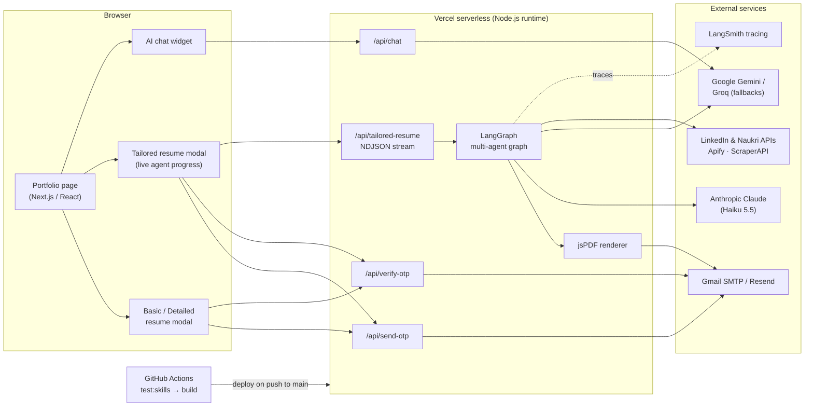
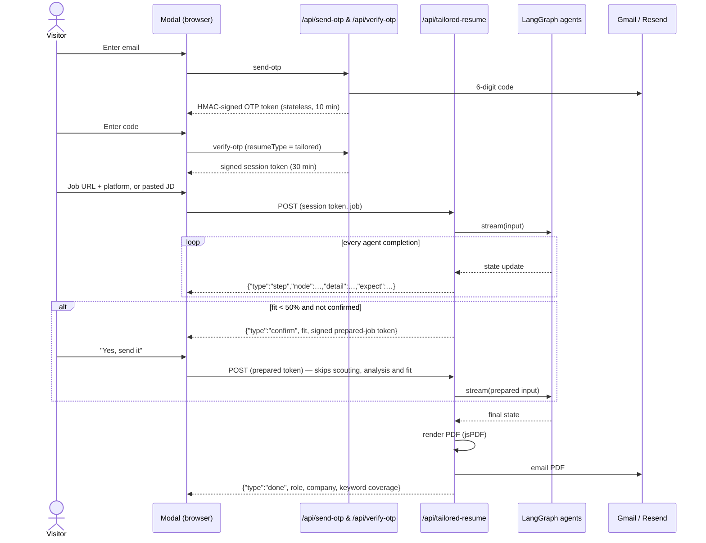
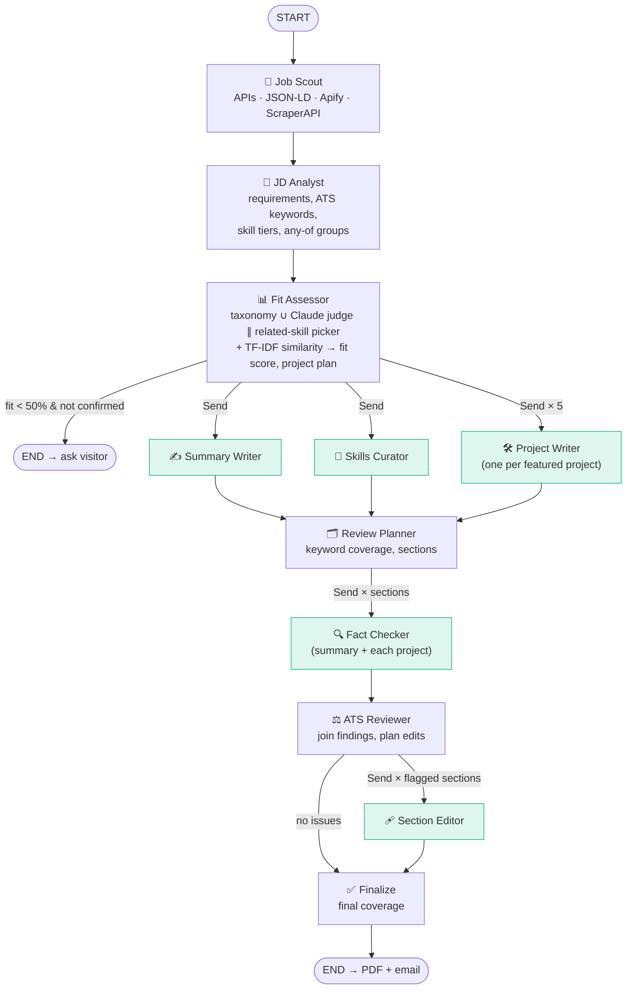
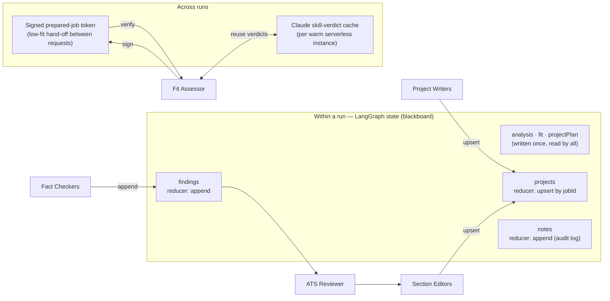
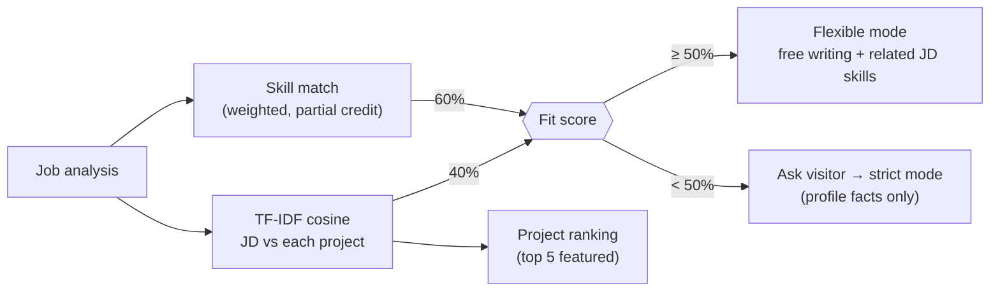
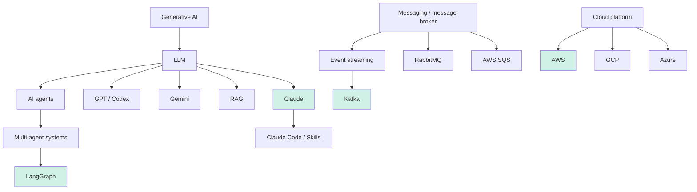

# Dinesh Kumar — Portfolio with an AI Multi-Agent Resume Tailor

**Live:** https://my-portfolio-dinesh-portfolio2.vercel.app

A Next.js portfolio for a senior full-stack engineer. Its main feature is an **agentic AI system** that reads any job posting and produces a **job-tailored, fact-checked resume PDF**. The resume is emailed after the visitor's email is verified.

Two engineering pieces sit behind it:

- **A multi-agent pipeline built with LangGraph.** Agents run in parallel fan-outs and share state.
- **An ML job-fit model.** It combines a priority-weighted skill match, a skill knowledge graph, an LLM judge and TF-IDF similarity. It was chosen by benchmarking 10 algorithm variants on an independently labelled dataset.

---

## Contents

- [What it does](#what-it-does)
- [Highlights](#highlights)
- [Tech stack](#tech-stack)
- [Application architecture](#application-architecture)
- [Feature design: the tailored resume](#feature-design-the-tailored-resume)
- [Agentic system design](#agentic-system-design)
- [ML work](#ml-work)
- [Truthfulness guardrails](#truthfulness-guardrails)
- [Performance engineering](#performance-engineering)
- [Project structure](#project-structure)
- [Running locally](#running-locally)
- [Deployment](#deployment)

---

## What it does

The **Resume** section offers three cards:

| Card | What happens |
|---|---|
| **Basic Resume** | 2-page, ATS-friendly PDF, emailed after OTP verification |
| **Detailed Resume** | Project-by-project deep dive for hiring managers, emailed after OTP verification |
| **Job-Tailored Resume** (AI) | The visitor verifies their email, then pastes a job URL (Naukri, LinkedIn, Indeed, Glassdoor, Wellfound, company careers pages…) or the job description. About 10 agents work on it, mostly in parallel, and a tailored PDF arrives by email with an ATS keyword-match score. |

If the role is a weak fit (below 50%), the visitor sees the fit score and the main missing requirements. They are asked whether they still want the resume before anything is generated.

## Highlights

- **Agentic AI.** A LangGraph `StateGraph` with 11 nodes and three dynamic fan-outs (`Send`): up to **7 agents run concurrently**. Shared graph state acts as the agents' blackboard. The UI streams each agent's progress live.
- **ML job-fit model.** Fit is 60% priority-weighted skill coverage plus 40% TF-IDF cosine similarity. Skills are weighted language > framework > library > tool > concept. "Any one of" requirements count once, and nice-to-haves count half.
- **Benchmarked skill matching.** A **skill taxonomy graph ∪ Claude judge** won against exact match, fuzzy n-grams, MiniLM/BGE sentence embeddings, Claude alone and other hybrids. On the held-out half it scored **85.5% macro-F1, 100% claim recall and 0 false claims**, against 37.5% for exact-word matching.
- **Guardrails against hallucinated claims.** Facts like employers, titles and dates are locked to the profile. LLM evidence quotes are verified verbatim. Parallel fact-checkers review every section and editors fix only the sections they flag.
- **Observability.** LangSmith traces every agent run, and visitor emails are hashed before being sent to the tracer.
- **Robust job ingestion.** It tries free sources first (LinkedIn guest API, Naukri job API, JSON-LD), then Apify and ScraperAPI. It has SSRF protection, rate-limit retries and graceful fallbacks.
- **Security.** Email OTP with HMAC-signed, expiring tokens. Signed hand-offs between requests. Prompt-injection-aware prompts, since job posts are treated as untrusted data.
- **CI/CD.** GitHub Actions runs the skill-matching regression test and the build, then deploys to Vercel.

## Tech stack

| Area | Libraries / services | Used for |
|---|---|---|
| App | **Next.js 14** (App Router), **React 18**, **TypeScript**, Tailwind | UI, API routes (serverless), streaming NDJSON responses |
| Agent orchestration | **LangGraph** (`@langchain/langgraph`) | `StateGraph`, conditional edges, `Send` fan-outs, reducers for shared state |
| LLM framework | **LangChain** (`@langchain/core`, `@langchain/anthropic`, `@langchain/google-genai`, `@langchain/groq`) | Structured outputs, provider fallbacks, retries, runnables |
| Models | **Claude Haiku 5.5** (primary), Gemini, Groq (fallbacks) | Analysis, matching, writing, fact-checking, editing |
| Tracing | **LangSmith** | Per-agent traces, latency and token usage |
| Validation | **Zod** | Typed LLM output schemas (JSON-schema structured outputs) |
| ML / NLP | Custom **TF-IDF + cosine similarity**, skill **knowledge graph**, LLM judge; **transformers.js** (MiniLM, BGE) and char n-gram TF-IDF in the benchmark | Job-fit scoring, semantic skill matching, project ranking |
| Job ingestion | LinkedIn guest API, Naukri job API, JSON-LD parsing, **Apify** (Indeed), **ScraperAPI** | Reading job posts that block plain fetches |
| PDF + email | **jsPDF**, **Nodemailer** (Gmail SMTP) / **Resend** | Resume rendering and delivery |
| Infra | **Vercel** (Fluid compute), **GitHub Actions** | Hosting, CI regression gate, deployment |

## Application architecture



## Feature design: the tailored resume



Design choices:

- **Stateless auth.** OTPs and sessions are HMAC-signed tokens with expiry, so no database is needed on serverless.
- **Streaming progress.** NDJSON over a `ReadableStream`. The UI shows each agent, its live counts for parallel fan-outs (e.g. "Project Writers 3/5") and a one-line result.
- **Signed hand-off.** A low-fit "yes" reuses the already-computed analysis through a signed token. The browser holds it but can't alter it, so a visitor can't force "flexible" mode.
- **Graceful degradation.** Any single writer, checker or editor can fail without sinking the resume; it falls back to the verified original text.

## Agentic system design



Green nodes run as **parallel instances**. Fan-outs use LangGraph's `Send` API, and multi-source edges act as barriers, so the Review Planner waits for every writer.

### Agents

| Agent | Type | Model / effort | Reads from shared state | Writes |
|---|---|---|---|---|
| Job Scout | tool agent (no LLM) | — | job URL / JD | `posting` |
| JD Analyst | LLM | Claude Haiku, low | `posting` | `analysis` (skills, ATS keywords, tiers, any-of groups) |
| Fit Assessor | ML + 2 concurrent LLM calls | low | `analysis`, `posting` | `fit`, `projectPlan` |
| Summary Writer | LLM | medium | `analysis`, `fit` | `summary` |
| Skills Curator | LLM + deterministic guard | medium | `analysis`, `fit` | `skills` |
| Project Writer × N | LLM (fan-out) | medium | one project + `analysis`, `fit` | `projects` (upsert by jobId) |
| Review Planner | deterministic | — | all drafts | `coverage`, `reviewSections` |
| Fact Checker × N | LLM (fan-out) | low | one section + its sources | `findings` (append) |
| ATS Reviewer | deterministic join | — | `findings`, `coverage` | `editPlan` |
| Section Editor × N | LLM (fan-out) | low | one flagged section + its findings | `summary` / `projects` (upsert) |
| Finalize | deterministic | — | final drafts | final `coverage` |

### Shared memory, data exchange and caching



- **Reducers make parallel writes safe.** Writers and editors upsert project drafts by id, and fact-checkers append findings.
- **The `notes` channel** is an append-only audit log, e.g. "related skills claimed", "editor fixed 2 claims". It's logged on the server and visible in LangSmith.
- **Provider resilience.** Each agent calls `Claude → Gemini → Groq` through LangChain `withFallbacks`, wrapped in a retry with backoff for rate limits. Daily-quota errors aren't retried.

## ML work

### 1. Job-fit model

```
fit = 0.6 × skill_match + 0.4 × semantic_similarity
```

**Skill match** is a weighted average over the job's requirements.

| Component | Rule |
|---|---|
| Credit per requirement | exact match **1.0** · equivalent (taxonomy / verified LLM evidence) **0.9** · related **0.5** · none **0** |
| Priority weight (tagged by the JD Analyst) | language **50** · framework **40** · library **30** · tool **20** · concept **10** |
| Importance | must-have × 1 · nice-to-have × 0.5 |
| "Any one of" groups | "Python, Java, Scala, Go or Rust" counts **once**, using the best option |

**Semantic similarity** is TF-IDF (unigrams + bigrams, sublinear TF, smoothed IDF) with cosine similarity between the job description and each profile project. The corpus is the profile's projects, so IDF rewards distinctive overlap. Scores were calibrated on sample JDs: NestJS backend 0.14, React 0.08, Java/Spring 0.05, Android/Kotlin 0.02, nursing 0.01. The per-project similarities also **rank which projects get featured**, with no extra LLM call.



### 2. Skill matching: knowledge graph ∪ LLM judge

The **skill taxonomy** (`skillTaxonomy.ts`) holds about 300 skills with synonyms (K8s = Kubernetes, ES6 = JavaScript), is-a hierarchy and related links. Matching is directional:

- **Downward is a claim.** A job asking for **LLM** is satisfied by a profile showing **Claude** or **RAG pipelines**. "Message broker" is satisfied by Kafka, "cloud" by AWS.
- **Siblings and upward are only related.** GCP vs AWS, Vite vs Webpack, and Snowflake vs MySQL are related, not claims. Broad roots ("programming language") don't create relations, so Kotlin is not related to Java.



Green nodes are in the profile, so a job asking for any of their ancestors (LLM, Generative AI, message broker, cloud) gets a claim. GCP or Azure get "related".

The **Claude judge** covers terms the taxonomy doesn't know. It must quote evidence from the profile, and **every quote is verified verbatim in code**; unverifiable matches are discarded. The shipped strategy takes the stronger of the taxonomy and judge verdicts.

### 3. Benchmark: how the algorithm was chosen

- **Independent labels.** A separate agent read only the profile and labelled **150 realistic job keywords** as `claim`, `related` or `none`. It never saw the implementation. The keywords span hierarchy, synonyms, sibling tools, near-misses (Java vs JavaScript, Go, C, R), domains, practices and data/AI terms.
- **No overfitting.** Fixed **dev/test split**: taxonomy fixes were made only from dev-half errors, and the test half was never inspected. Vector methods got thresholds tuned with **5-fold cross-validation**.
- **Metrics.** Macro-F1 across the 3 classes, plus claim precision, recall and F0.5. False claims (`none` → `claim`) are tracked separately because they're the costliest error on a resume.

| Algorithm | Test macro-F1 | Claim precision | Claim recall | False claims |
|---|---|---|---|---|
| **Taxonomy ∪ Claude judge (shipped)** | **85.5%** | 95.8% | **100%** | **0** |
| Taxonomy + Claude fallback | 84.3% | 95.7% | 98.5% | 0 |
| Skill taxonomy graph only | 82.0% | 95.6% | 95.6% | 0 |
| Claude judge only | 75–81% | ≈100% | ≈90% | 0 (misses siblings) |
| Claude judge + taxonomy veto | 74–78% | 95.8% | 100% | 0 |
| Sentence embeddings: all-MiniLM-L6-v2 | 49.6% | 69.2% | 66.2% | 10 |
| Sentence embeddings: bge-small-en-v1.5 | 45.9% | 70.2% | 58.8% | 6 |
| Char n-gram TF-IDF (fuzzy) | 45.2% | 76.9% | 58.8% | 5 |
| Exact-word baseline | 37.5% | 96.3% | 38.2% | 0 |

- **Embeddings struggle with short technical terms.** MiniLM rated "LLM" closer to "Kotlin" than to "Claude", and "Java" close to "JavaScript", so similarity alone produces false claims.
- **The knowledge graph and the LLM fail differently**, and their union beats both.
- **Regression gate.** `npm run test:skills` runs the deterministic part in CI (macro-F1 ≥ 85%, claim precision ≥ 92%, zero false claims). `npm run eval:skills` reruns the whole benchmark.

Dataset and results: [`scripts/skill-match-eval/`](scripts/skill-match-eval/).

## Truthfulness guardrails

A tailored resume is only useful if it's honest, so several layers enforce that:

1. **The source of truth is `src/data/profile.ts`.** Employers, titles, dates, education, metrics and achievements can only come from there.
2. **Deterministic guards.** Projects are referenced by id, so the model can't invent a job, and role, company and dates are filled in by code. Skills must exist in the profile or in the approved related-skill list. Related skills must come from the job description itself.
3. **Verified evidence.** Every LLM skill match must quote the profile verbatim.
4. **Parallel fact-checkers** review every section against its own sources, and **section editors** rewrite only what was flagged. If an editor fails on a flagged project, the original bullets are used.
5. **Fit-dependent freedom.** At ≥50% fit, agents write freely and may claim related skills that fit the stack. Below 50%, the visitor is asked first, and generation is strict.
6. **Prompt-injection hygiene.** Job posts are wrapped and marked as untrusted data, and output is schema-validated.

## Performance engineering

Measured per agent, then optimized:

| Change | Effect |
|---|---|
| Single Experience Tailor → **5 parallel Project Writers** | Experience section ≈12s → ≈5s |
| Single reviewer → **parallel Fact Checkers** per section | ≈10s → ≈4–5s |
| Single editor (whole resume) → **parallel Section Editors** (flagged only) | ≈15–19s → ≈2–5s, often skipped |
| Fit Assessor: **concurrent** Claude judge + speculative related-skill picker | removes one sequential LLM round-trip |
| Claude **effort tuning**: low for extraction, checking and editing; medium for writers | 2–7× faster calls; matching accuracy unchanged (85.5% vs 85.7%) |
| Cross-run **verdict cache** + signed low-fit hand-off | repeat keywords skip Claude; "yes" path ≈14s instead of a full rerun |

| Job | Before | After |
|---|---|---|
| React developer | 24–40s | **≈20s** |
| Backend / Data / AI | 54–57s | **≈24s** |

## Project structure

```
src/
  app/
    page.tsx                         # portfolio page
    api/
      tailored-resume/route.ts       # streams the agent graph (NDJSON), renders + emails the PDF
      send-otp/ verify-otp/          # stateless HMAC OTP + session tokens
      chat/                          # AI chat widget (Gemini → Groq)
  components/
    ResumeSection.tsx                # 3 resume cards
    TailoredResumeModal.tsx          # job input, live agent progress, low-fit confirmation
    OtpVerification.tsx              # shared email → OTP flow
  data/
    profile.ts                       # single source of truth for career facts
    jobPlatforms.ts                  # platform list + URL auto-detection
  lib/
    resumeAgents/
      graph.ts                       # LangGraph: agents, shared state, fan-outs
      skillMatch.ts                  # lexical / taxonomy / Claude-judge matchers + hybrids
      skillTaxonomy.ts               # skill knowledge graph
      similarity.ts                  # TF-IDF cosine similarity
      jobIngest.ts                   # job fetching chain + SSRF guard
      llm.ts                         # Claude → Gemini → Groq fallbacks, retries, effort
    resumePdf.ts  resumeEmail.ts  otpStore.ts
scripts/skill-match-eval/            # labelled dataset, benchmark harness, CI regression test
```

## Running locally

```bash
nvm use 22
npm install
cp .env.local.example .env.local   # fill in keys (see below)
npm run dev                        # http://localhost:3000
```

| Script | Purpose |
|---|---|
| `npm run dev` / `build` / `start` | Next.js |
| `npm run test:skills` | Skill-matching regression gate (offline, no API calls) |
| `npm run eval:skills` | Full benchmark of all matching algorithms (uses Claude; add `--no-llm` / `--no-embeddings`) |

Key environment variables:

- **AI:** `ANTHROPIC_API_KEY` (primary model), plus `GOOGLE_API_KEY` and `GROQ_API_KEY` (fallbacks and the chat widget).
- **Email:** `EMAIL_USER` and `EMAIL_APP_PASSWORD` (Gmail SMTP), or `RESEND_API_KEY`.
- **Security:** `OTP_SIGNING_SECRET`.
- **Job scraping:** `APIFY_API_TOKEN`, `SCRAPERAPI_KEY` (both optional).
- **Tracing:** `LANGSMITH_TRACING`, `LANGSMITH_API_KEY`, `LANGSMITH_PROJECT` (optional).

See `.env.local.example`.

## Deployment

Every push to `main` runs **GitHub Actions**: install → `test:skills` → build. A second workflow pulls production env vars from Vercel, builds with `vercel build --prod` and deploys the prebuilt output. Details are in [DEPLOYMENT.md](DEPLOYMENT.md).
